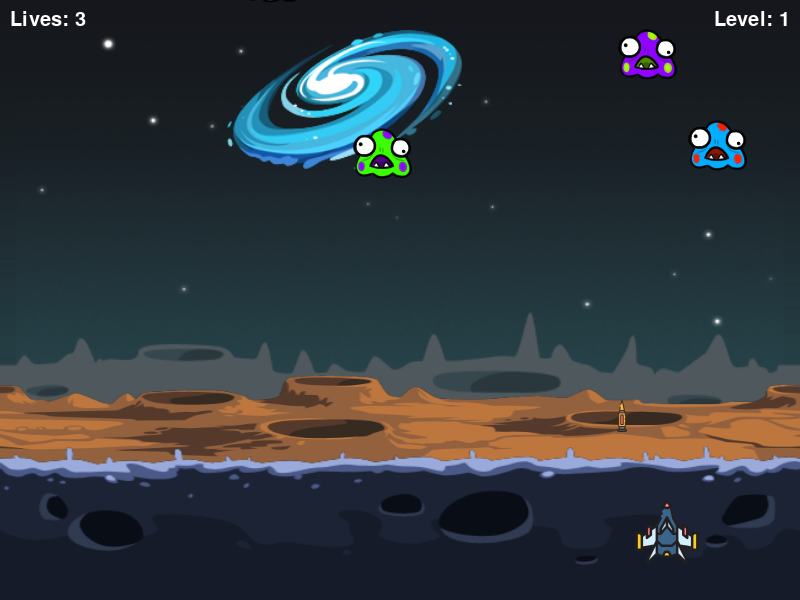

# Space Invaders

Pygame shooter built during the Hybridge course Programación Avanzada (Programación Aplicada). Checkpoint 1 version: the player ship moves and fires, enemies fall, and the HUD shows lives, level and loaded bullets.



```
space-invaders/
├── main.py           # game loop
├── settings.py       # WIDTH, HEIGHT
├── assets.py         # image loading relative to this folder
├── GameClass.py      # Game: lives, level, HUD, game over, quit event
├── ShipClass.py      # Ship: base class (position, health, draw)
├── PlayerClass.py    # Player(Ship): movement, bullets, cooldowns, hit
├── EnemyClass.py     # Enemy(Ship): colors, move, create waves, speed
├── BulletClass.py    # Bullet: move, draw, mask collision
├── DrawingClass.py   # Drawing: background, ships, HUD per frame
└── img/              # sprites provided by the course
```

## Run

```bash
python3 -m venv .venv
.venv/bin/python -m pip install -r requirements.txt
.venv/bin/python main.py
```

Keys: arrows or `WASD` move, `SPACE` fire, close the window to quit.
